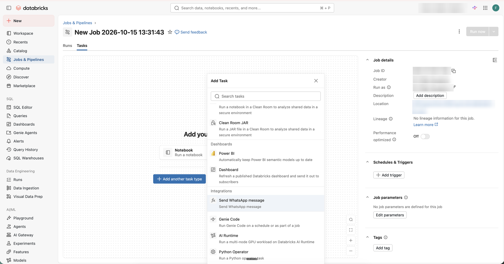

# Custom Lakeflow Jobs task built with Genie Code

Companion repository for the article *Databricks can send WhatsApp messages and much more: build reusable Lakeflow Jobs tasks with Genie Code*.

It shows how to use Genie Code inside a Databricks workspace to create, validate, test and version a [Lakeflow Integration](https://docs.databricks.com/aws/en/jobs/tasks/lakeflow-integrations): a custom task type for Lakeflow Jobs. The example sends a WhatsApp message through Twilio, but the same pattern works for any API call, notification or custom code you want to offer as a standard, governed task.

## What is here

| Path | What it is |
|---|---|
| [`prompts/genie-code-phases.md`](prompts/genie-code-phases.md) | The phased prompts used with Genie Code, each with its own checks |
| [`example/custom_whatsapp_task/`](example/custom_whatsapp_task/) | The bundle Genie Code produced from the Lakeflow Integrations (Beta) template, after validation |
| [`docs/images/`](docs/images/) | Screenshots used in the article |

## How to use it

1. Enable the Lakeflow Integrations Beta in your workspace (an admin does it under Previews).
2. Create a Git folder, then Create > Bundle > Lakeflow Integrations (Beta).
3. Open Genie Code in agent mode and follow [`prompts/genie-code-phases.md`](prompts/genie-code-phases.md) one phase at a time.

Use the files in `example/` as a reference for what each phase should produce, not as something to copy blindly. The template in your workspace may differ slightly.

## Notes

- Lakeflow Integrations is in Beta. Behavior and APIs may change.
- Twilio is used because its WhatsApp sandbox is ready in minutes. Any HTTP API works the same way.
- No credentials or real phone numbers are stored here. Credentials live in a Databricks secret scope.

Disclosure: I work at Databricks. Opinions here are my own.
