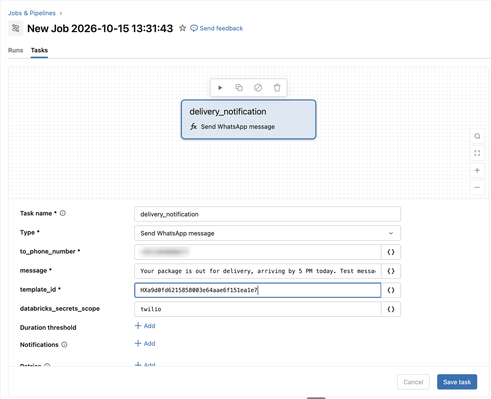

# Example bundle: Send WhatsApp message

A Declarative Automation Bundle created from the Lakeflow Integrations (Beta) template and adapted by Genie Code. It was deployed and run end to end, and the message reached the phone.

| File | Role |
|---|---|
| `custom_whatsapp_task/src/custom_whatsapp_task/whatsapp.py` | The function decorated with `@integration`. Its arguments become the task form fields. |
| `custom_whatsapp_task/resources/send_whatsapp_message.job.yml` | A sample job. Declares job parameters and passes them to the task with `{{job.parameters.*}}`. |
| `custom_whatsapp_task/databricks.yml` | Builds the wheel and regenerates the integration YAML on every deploy. |
| `custom_whatsapp_task/pyproject.toml` | Package definition and the `databricks-lakeflow-integrations` dependency. |

Before deploying, set `host` in `databricks.yml` and create a secret scope `twilio` with the keys `account_sid`, `auth_token` and `from_number`.

```bash
cd custom_whatsapp_task
databricks bundle deploy --target dev
databricks bundle run send_whatsapp_message --target dev \
  --params "to_phone_number=+5511999999999,template_id=HX..."
```

Start a new run to change parameters. Repair reuses the configuration of the original run.


