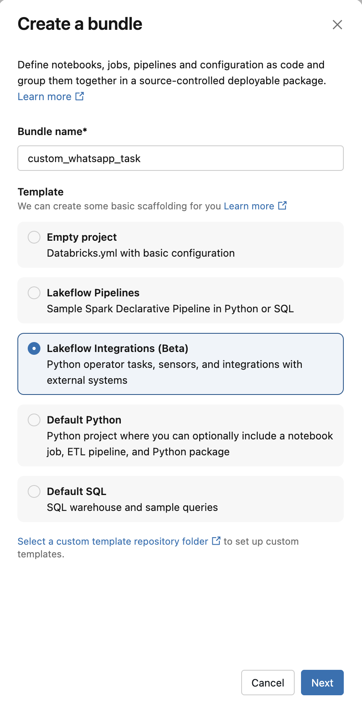

# Building a WhatsApp integration for Lakeflow Jobs with Genie Code

This guide shows how to build a custom Lakeflow Jobs task that sends WhatsApp messages through Twilio, entirely inside the workspace and without a terminal. Genie Code does the heavy lifting. You paste one prompt per phase, check the result, and only move on once the checks pass.

There are eight phases:

| Phase | What happens | Who does it |
|---|---|---|
| 0 | Set up Twilio and a Git repository, and enable the Beta | You |
| 1 | Create the Git folder and the bundle from the Lakeflow Integrations template | You + Genie Code |
| 2 | Check that the workspace can reach Twilio | Genie Code |
| 3 | Store the credentials in Databricks Secrets | Genie Code + you |
| 4 | Send a test message from a notebook | Genie Code |
| 5 | Turn the template bundle into a WhatsApp integration and deploy it | Genie Code |
| 6 | Check the deployed artifacts, run the job with bundle run, and commit | Genie Code |
| 7 | Register the integration and use it from the Jobs UI | Genie Code + you |

Everything you create lives inside the Git folder, with this layout:

```text
<repository>/                       Git folder
  .gitignore
  setup/                            helper notebooks, outside the bundle
    00_check_environment
    01_create_secrets               in .gitignore, delete after use
    02_test_twilio
  custom_whatsapp_task/             the bundle (root has databricks.yml)
    databricks.yml
    pyproject.toml
    resources/
    src/custom_whatsapp_task/
```

`setup/` sits outside the bundle on purpose. The notebooks get versioned in Git but are not part of the deploy.

In the prompts, replace `<GIT_FOLDER>` with the path to your Git folder, for example `/Workspace/Users/maria@company.com/whatsapp-integration`.

The phases are ordered to isolate problems. If phase 4 works and phase 7 does not, the issue is in the packaging, not in Twilio or the network.

## Phase 0. Preparation

On Twilio:

1. Create a trial account and go to Messaging > Try out WhatsApp in the [Twilio Console](https://console.twilio.com/).
2. From the phone that will receive the messages, send `join <code>` to the sandbox number. Sandbox membership expires after a few days, so repeat this the day before any demo.
3. Collect the three credentials and the template ID. They are stored as secrets in phase 3, and getting any of them wrong is the most common reason the integration fails.

| Secret key | Where to find it | What it looks like | Common mistakes |
|---|---|---|---|
| `account_sid` | Twilio Console home page, Account Info panel | Starts with `AC`, 34 characters | Using an API Key SID (starts with `SK`) or the Test Account SID, which never sends real messages |
| `auth_token` | Same Account Info panel. Click to reveal and copy it | 32 hexadecimal characters | Copying it with a trailing space or line break. Using the test Auth Token |
| `from_number` | Messaging > Try it out > Send a WhatsApp message, shown as the sandbox number | E.164 with no spaces, for example `+14155238886` | Adding the `whatsapp:` prefix (the code already adds it), leaving spaces or dashes, or using your own phone number |
| Template `ContentSid` | Same sandbox page, in the sample message templates | Starts with `HX` | It is not a secret: it goes in the task parameters, not in the scope |

If you regenerate the Auth Token in Twilio, the old one stops working right away and the secret has to be updated.

On Git:

1. Create an empty repository on your provider (GitHub, GitLab, Azure DevOps, Bitbucket). In the workspace, bundles can only be created inside a Git folder.
2. In Databricks, link your Git account under Settings > Linked accounts.
3. If your GitHub organization uses an IP allow list, the workspace cannot clone until an admin allows the Databricks IPs. For a test, a personal repository without that restriction is the quickest path.

On Databricks:

1. Enable the Lakeflow Integrations Beta. A workspace admin clicks their username in the top right corner, opens **Previews**, looks for "Lakeflow Integrations" and turns it on. The setting applies to the whole workspace and only admins can change it. If it is not in the list, the Beta has not been made available to that workspace yet. In that case, reach out to your Databricks account team or write to lakeflow-integrations-private-preview@databricks.com.
2. Make sure the workspace has serverless and workspace files enabled.

One rule for the whole guide: never paste an Auth Token into a prompt. Genie Code does not need to see credentials for anything here.

## Phase 1. Git folder and bundle from the template

Steps 1 to 4 happen in the UI, following the [workspace bundle tutorial](https://docs.databricks.com/aws/en/dev-tools/bundles/workspace-tutorial).

1. **Create the Git folder.** Go to Workspace > your user folder > Create > Git folder, paste the URL of the empty repository and confirm.
2. **Create the bundle.** Inside the Git folder, click Create > Bundle, or right-click the folder and choose Create > Bundle.
3. **Name it.** Under Bundle name, use `custom_whatsapp_task`. The name becomes the Python package name, and the prompts in the next phases rely on it. Only letters, numbers, dashes and underscores are allowed.
4. **Pick the template.** Under Template, choose **Lakeflow Integrations (Beta)** and click Next. Do not use "Empty project". If the option is missing, the Beta is not enabled (phase 0).



The template creates a deploy-ready project with a sample Slack integration, a sample sensor, their jobs, `databricks.yml`, `pyproject.toml` and `uv.lock`. Do not deploy yet.

Now open Genie Code in the side panel, in agent mode, with the Git folder open. Prompt:

```text
I'm going to build a Lakeflow Integration (a custom Lakeflow Jobs task) that sends
WhatsApp messages through the Twilio API. Reference:
https://docs.databricks.com/aws/en/jobs/tasks/lakeflow-integrations

My Git folder is <GIT_FOLDER>. Inside it I just created the bundle
custom_whatsapp_task from the Lakeflow Integrations template.

Rule for all the work from now on: create files and notebooks only inside
<GIT_FOLDER>. Helper notebooks go in <GIT_FOLDER>/setup/, outside the bundle.
Do not create anything in my user folder or anywhere else.

For this step, without changing the bundle:

1. Create the folder <GIT_FOLDER>/setup/.
2. Create or update <GIT_FOLDER>/.gitignore with a line that ignores the
   setup/01_create_secrets notebook (use a pattern that matches any extension,
   such as setup/01_create_secrets*).
3. Show me the file tree of <GIT_FOLDER>.
4. Show me custom_whatsapp_task/databricks.yml, especially the artifacts section.
5. List the functions and classes decorated with @integration in
   custom_whatsapp_task/src/ and the jobs defined in custom_whatsapp_task/resources/.
```

Checks:

- [ ] `custom_whatsapp_task/databricks.yml` exists, and the package under `src/` is named `custom_whatsapp_task`.
- [ ] `setup/` exists and `.gitignore` has the `01_create_secrets` line.
- [ ] The `build` of the `lakeflow_integrations_yaml` artifact calls the generator (`databricks.lakeflow.integrations.generator`), and `files` points to `__generated__/*.yml`. That is what the template creates. If you see `build: "true"` instead, the YAML would not be regenerated on deploy and the form would never reflect your function.

## Phase 2. Check the environment

Prompt:

```text
Create the Python notebook <GIT_FOLDER>/setup/00_check_environment, running on
serverless, and do the following:

1. Show the current user and the workspace host.
2. Send a GET to https://api.twilio.com/2010-04-01/Accounts.json with a 10 second
   timeout and no authentication. I expect HTTP 401. Any connection error or
   timeout means serverless has no internet egress.
3. Run %pip install databricks-lakeflow-integrations and import
   databricks.lakeflow.integrations.integration to prove the package installs.
4. List the secret scopes I already have.

At the end, give me a table with each check, the result and what to do if it
failed. Do not move on to any other step.
```

Checks:

- [ ] The GET returns **401**. If it times out or fails to connect, ask an admin to allow `api.twilio.com` in the serverless network policy before going further.
- [ ] The import works.

## Phase 3. Credentials in Secrets

Prompt:

```text
Create the notebook <GIT_FOLDER>/setup/01_create_secrets, which uses the
Databricks SDK (WorkspaceClient) to:

1. Create the secret scope "twilio" if it does not exist yet.
2. Store three secrets: account_sid, auth_token and from_number.

The values must come from three variables at the top of the notebook, which I
will fill in by hand. Leave those variables empty and do not write any real value.
from_number is the sandbox number in E.164 format (+14155238886), without the
"whatsapp:" prefix.

Before storing anything, strip leading and trailing whitespace from the three
values and validate the format. Stop with a clear error if any check fails:
- account_sid starts with "AC" and has 34 characters (if it starts with "SK",
  say it is an API Key SID, not the Account SID);
- auth_token has 32 hexadecimal characters;
- from_number matches ^\+[1-9]\d{7,14}$ and does not contain "whatsapp:".

After storing them:
1. List the keys in the scope (names only, never values) and confirm all three
   exist.
2. Put the validation in a separate cell named "Validate secrets" that reads the
   values back with dbutils.secrets.get, runs the same format checks, and calls
   GET https://api.twilio.com/2010-04-01/Accounts/{account_sid}.json with
   auth=(account_sid, auth_token) and timeout=10. HTTP 200 means the SID and
   token pair is valid. HTTP 401 means one of them is wrong. Show only
   pass/fail for each check and the account "status" and "type" fields from the
   response (type "Trial" is expected).

Never print a secret value, not even partially, at any point.

Before finishing, confirm that this notebook is ignored by Git (it must not show
up in the Git folder's pending changes).
```

What you do: fill in the three variables and run the notebook. Once the "Validate secrets" cell passes, delete the notebook. Revision history keeps whatever was typed, so clearing the cell is not enough.

Checks:

- [ ] The listing shows `account_sid`, `auth_token` and `from_number`.
- [ ] Every format check passes.
- [ ] The Twilio account call returns **200**, with account status `active`.
- [ ] The `01_create_secrets` notebook does not appear in the Git folder changes.

If the account call returns 401, fix the values and run the notebook again. `put_secret` overwrites the existing value, so there is no need to delete the scope.

## Phase 4. Test message from a notebook

Prompt:

```text
Create the notebook <GIT_FOLDER>/setup/02_test_twilio, which sends a WhatsApp
message through Twilio without any integration yet, just to validate the
credentials and the sandbox.

- Read account_sid, auth_token and from_number from the "twilio" scope with
  dbutils.secrets.
- Use widgets for to_phone_number, message and template_id, with empty defaults.
- Send a POST to https://api.twilio.com/2010-04-01/Accounts/{sid}/Messages.json
  with From="whatsapp:{from_number}", To="whatsapp:{to_phone_number}",
  ContentSid=template_id and ContentVariables=json.dumps({"1": message}).
  Use auth=(sid, token) and timeout=30.
- If the status is not 201, show the status and Twilio's error message.
- If it is 201, keep the message SID, wait 10 seconds and call
  GET .../Messages/{SID}.json to show the final status and error_code.
- In a separate cell, list the last 5 messages on the account with to, status
  and error_code. It will be used for troubleshooting later.
```

What you do: fill in the widgets with your number and the `ContentSid`, and run it.

Checks:

- [ ] The message arrives on the phone.
- [ ] The final status is `delivered` or `read`. If it shows `failed` or `undelivered` with error **63015**, the phone left the sandbox: send the `join` again.

Do not move on until this phase works. Everything after this just packages the same code.

## Phase 5. Turn the bundle into a WhatsApp integration

Prompt:

```text
The notebook test worked. Now adapt the bundle <GIT_FOLDER>/custom_whatsapp_task
(created from the Lakeflow Integrations template) so it has a single integration:
sending WhatsApp messages through Twilio.

1. Remove the template examples (the Slack integration, the sensor and their
   jobs in resources/). Keep __init__.py and the package structure.

2. Create src/custom_whatsapp_task/whatsapp.py with a function
   send_whatsapp_message(to_phone_number: str, message: str, template_id: str,
   databricks_secrets_scope: str = "twilio"), decorated with
   @integration(display_name="Send WhatsApp message") imported from
   databricks.lakeflow.integrations. It sends the same POST as the
   setup/02_test_twilio notebook. Import dbutils inside the function with
   "from databricks.sdk.runtime import dbutils". Raise an exception if the
   status is not 201 and print the SID when it succeeds.

3. Create resources/send_whatsapp_message.job.yml with:
   - JOB parameters to_phone_number, message, template_id and
     databricks_secrets_scope, with dummy defaults (+5511999999999, and
     "twilio" for the scope);
   - a python_operator_task with main
     custom_whatsapp_task.whatsapp.send_whatsapp_message, where each task
     parameter references the job parameter with {{job.parameters.<name>}};
   - the same serverless environment the sample jobs used
     (dependency ../dist/*.whl).

4. Leave the artifacts section of databricks.yml as the template created it.
   The lakeflow_integrations_yaml artifact already runs the generator
   (databricks.lakeflow.integrations.generator) on every deploy, which rebuilds
   the integration YAML from the function signature. Only check that its
   --environment-key matches the environment_key used in the job, and keep the
   files pattern the template set (__generated__/*.yml).

   If, and only if, the build is "true" instead of calling the generator, stop
   and tell me before changing it.

5. Do not touch uv.lock, the targets or the host.

6. Show me the bundle file tree, whatsapp.py, the job and the artifacts section
   of databricks.yml.

7. From the bundle root (<GIT_FOLDER>/custom_whatsapp_task), run
   databricks bundle validate --target dev
   and fix any error it reports. When validation passes, run
   databricks bundle deploy --target dev
   and show me the full output. If the deploy fails, show me the error and stop.
   Do not change the code to work around a deploy error without asking me first.
   Do not commit yet.
```

If Genie Code cannot run the CLI in your workspace, do the deploy from the UI instead, as described in phase 6.

Checks:

- [ ] No references to Slack or the sample sensor are left.
- [ ] The artifacts section of `databricks.yml` is unchanged from the template, and `--environment-key` matches the job.
- [ ] The function arguments are exactly `to_phone_number`, `message`, `template_id` and `databricks_secrets_scope`. These names become the form fields.
- [ ] The job has job parameters and the task uses `{{job.parameters.*}}`.
- [ ] No real phone number or credential in any file.
- [ ] `databricks bundle validate --target dev` passes.
- [ ] `databricks bundle deploy --target dev` finishes without errors. The output shows the wheel being built and the integration YAML being uploaded.

## Phase 6. Check the deploy

If the deploy already ran at the end of phase 5, skip straight to the prompt below. Otherwise, deploy from the UI: click the rocket icon in the left sidebar to open the Deployments panel, pick the `dev` target and click Deploy. Confirm in the dialog.

Either way, the deploy uploads the wheel and the integration YAML to the workspace and creates the bundle jobs. According to the documentation, the deploy does not register the integration, and phase 7 covers that. In our tests, a deploy from the workspace made the integration show up under Add task right away, so phase 7 starts by checking that first.

After the deploy, prompt:

```text
I deployed the custom_whatsapp_task bundle to the dev target. Check:

1. List the files in
   /Workspace/Users/<my_user>/.bundle/custom_whatsapp_task/dev/artifacts/.internal
   I expect a .whl and one integration definition file (.yml or .yaml), and no
   definitions for the template examples. Tell me the extension.
2. Read the definition file and show me: name, main, the config properties and
   the environment dependencies. The dependency must be an absolute path to the
   .whl.
3. Find the "[dev ...] send_whatsapp_message" job and show me its job parameters
   and task parameters.
4. Confirm that the template's sample jobs were not created.
5. Confirm that the setup/ folder was not uploaded by the deploy (it is outside
   the bundle).
```

Checks:

- [ ] The definition file exists, with `name: Send WhatsApp message` and the four properties.
- [ ] The dependency is an absolute path under `/Workspace/...`.
- [ ] The definition file ends in `.yml`. If it ends in `.yaml` (it happens with some generator versions), use that extension in the registration in phase 7.

If the file is missing, or it comes with the properties of the Slack example, the problem is in the artifact's `build` or `files`. Go back to phase 5.

### Run the job from the bundle

The bundle job calls the Python function directly, so it works before the integration is registered. That makes it a good test of the packaging on its own.

Prompt (replace `<YOUR_NUMBER>` and `<CONTENT_SID>` with your values):

```text
From the bundle root (<GIT_FOLDER>/custom_whatsapp_task), run the job with:

databricks bundle run send_whatsapp_message --target dev --params "to_phone_number=<YOUR_NUMBER>,template_id=<CONTENT_SID>,message=Hello from Databricks"

Wait for it to finish and show me:
1. The run URL and the final state.
2. The values the task actually received for to_phone_number, message and
   template_id. They must be the ones I passed, not the dummy defaults.
3. If the run failed, the error from the first attempt of the task.

Then run the last cell of <GIT_FOLDER>/setup/02_test_twilio and show me the
status and error_code of the most recent message.
```

If Genie Code cannot run the CLI, open the job in the UI and use Run now with different parameters with the same values. Do not use Repair to retry: it reuses the configuration of the original run and ignores the new values.

Checks:

- [ ] The run finishes as Succeeded.
- [ ] The task received your number, not `+5511999999999`.
- [ ] The message arrives on the phone, and the latest Twilio message shows `delivered` or `read`.

### Commit and push to Git

Commit only now, after the run has proved the integration works end to end. That way the repository never holds a version that deploys but does not send.

Prompt:

```text
The bundle run worked. Commit and push the Git folder <GIT_FOLDER> to the remote
branch with the message "Add WhatsApp Lakeflow Integration".

Before committing, show me the list of changed files and confirm that:
- setup/01_create_secrets is not in the list;
- no __generated__/, dist/ or .venv/ files are in the list;
- no file contains a real phone number or credential (the job defaults must
  still be the dummy +5511999999999).
If any of these fails, stop and tell me instead of committing.

After pushing, show me the commit hash and the branch.
```

If Genie Code cannot commit, do it from the Git folder: click the branch name, review the changes and click Commit & Push.

Checks:

- [ ] The commit shows up in the remote repository, with `setup/00_check_environment`, `setup/02_test_twilio` and the bundle.
- [ ] `01_create_secrets`, `__generated__/` and `dist/` are not in the commit.

## Phase 7. Register and use

First, check whether the integration already shows up: reload the Jobs page, create a new job, click Add task and look for **Send WhatsApp message** under Integrations. In our tests it was already there after a deploy from the workspace. If it is, skip the registration prompt below and go straight to "What you do".

If it does not show up, register it. The documentation says integrations are listed from a `.lakeflow_integrations.yml` file. This is the only file in the guide that lives outside the Git folder, because the platform looks for it in fixed locations:

- `/Workspace/Users/<user>/.lakeflow_integrations.yml`: only you see the integration. Recommended for testing.
- `/Workspace/.lakeflow_integrations.yml`: every user sees it, as long as they can read this file and the wheel. It requires write access to the workspace root, which is usually admin-only.

Prompt (only if the integration is not listed yet):

```text
Register the integration for my user. This is the only file that should live
outside the Git folder. Create /Workspace/Users/<my_user>/.lakeflow_integrations.yml
with this content:

integrations:
  - '/Workspace/Users/<my_user>/.bundle/custom_whatsapp_task/dev/artifacts/.internal/*.yml'

If the definition file you found in .internal in the previous phase ends in
.yaml instead of .yml, use *.yaml in the glob.

If the file already exists, append the line without removing the others. Then
read the file back and show it to me, and confirm the glob matches the
definition file by listing the files in .internal with that extension.
```

What you do:

1. Reload the Jobs page.
2. Create a new job and choose Add task > Integrations > **Send WhatsApp message**.

   

3. Fill in the fields with your number, some text and the `ContentSid`, click Save task and then Run now. The fields come straight from the function arguments, and the `{}` button next to each one lets you use dynamic values such as job parameters or task values.

   

4. If you changed anything in the Git folder after phase 6, commit and push again. The `.lakeflow_integrations.yml` file lives outside the Git folder, so registering the integration does not create anything to commit.

Checks:

- [ ] The integration shows up in the Integrations list.
- [ ] The run finishes as Succeeded.
- [ ] The message arrives on the phone.

If the message does not arrive, run the last cell of `setup/02_test_twilio` to see the status and error_code of the latest messages.

## Troubleshooting

| Symptom | Likely cause | What to do |
|---|---|---|
| Create > Bundle is not available | You are not inside a Git folder, or workspace files is disabled | Create the bundle inside the Git folder |
| The Lakeflow Integrations template is missing, or there is no Integrations section under Add task | The Beta is not enabled in the workspace | Admin turns it on under Previews (phase 0), then reload the page |
| The Git folder fails to clone because of an IP allow list | The Git organization blocks the Databricks IP | Allow the IP or use a different repository |
| Genie Code created files outside the Git folder | The prompt was not explicit about where to create them | Repeat the rule from phase 1 and ask it to move the files |
| The form shows the fields of the Slack example | The YAML is not regenerated on deploy | Fix the artifact `build` (phase 5) |
| The integration does not show up under Add task after the deploy | It is not registered. Either `.lakeflow_integrations.yml` is missing or it points to the wrong extension | Do phase 7, check the glob matches the real extension and reload the page |
| The run succeeded but the message never arrives | Twilio accepted it but did not deliver. Usually the phone left the sandbox | Send the `join` again and check the error_code (63015) |
| The task uses the default values instead of what you typed | You used Repair, or the job has no job parameters | Start a new run |
| "Task failed due to an internal error" with no detail | Common on repairs, and it hides the real error | Look at the first attempt of the run |
| Timeout when calling Twilio | Serverless has no internet egress | Ask an admin to allow `api.twilio.com` |
| Twilio returns 401 or error 20003 | `account_sid` or `auth_token` is wrong, has extra whitespace, or the token was regenerated | Run the "Validate secrets" cell from phase 3 and store the values again |
| Twilio error 21212 or 63007 | `from_number` is not the sandbox number, or it is badly formatted | Copy the sandbox number again, in E.164 and without `whatsapp:` |
| `Secret does not exist` or scope not found | The scope or key name differs from what the code expects | Scope `twilio` and keys `account_sid`, `auth_token`, `from_number`, all lowercase |

## Beyond WhatsApp

Twilio is used here because the sandbox is ready in minutes. To use the Meta WhatsApp Business Cloud API, or a broker such as Zenvia, Infobip, Gupshup or Blip, repeat phases 3 and 4 with the new API and ask Genie Code to change only the HTTP call in `whatsapp.py`. The bundle, the registration and the Jobs experience stay the same.

The same playbook works for any other custom task: opening a ServiceNow ticket, posting to Teams, calling an internal webhook, or waiting for a file to land with a `Sensor`. The Lakeflow Integrations template already ships a sample sensor you can start from.

## References

- [Lakeflow Integrations](https://docs.databricks.com/aws/en/jobs/tasks/lakeflow-integrations)
- [Bundles in the workspace](https://docs.databricks.com/aws/en/dev-tools/bundles/workspace-bundles)
- [Tutorial: create and deploy a bundle in the workspace](https://docs.databricks.com/aws/en/dev-tools/bundles/workspace-tutorial)
- [Manage previews](https://docs.databricks.com/aws/en/admin/workspace-settings/manage-previews)
- [Try out WhatsApp (Twilio)](https://www.twilio.com/docs/usage/trials/try-out-whatsapp)
